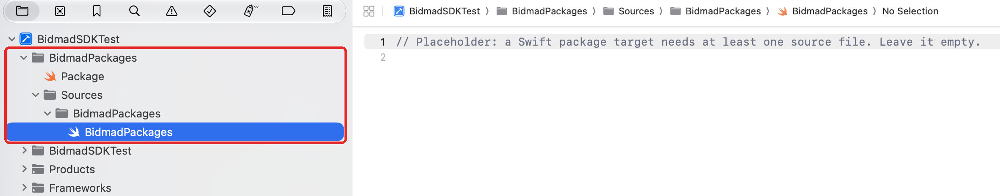
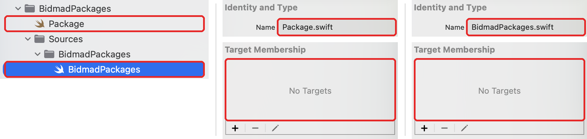
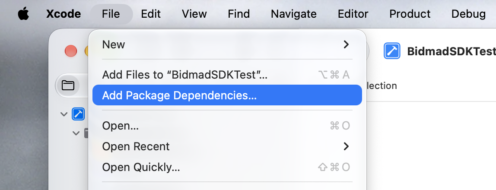
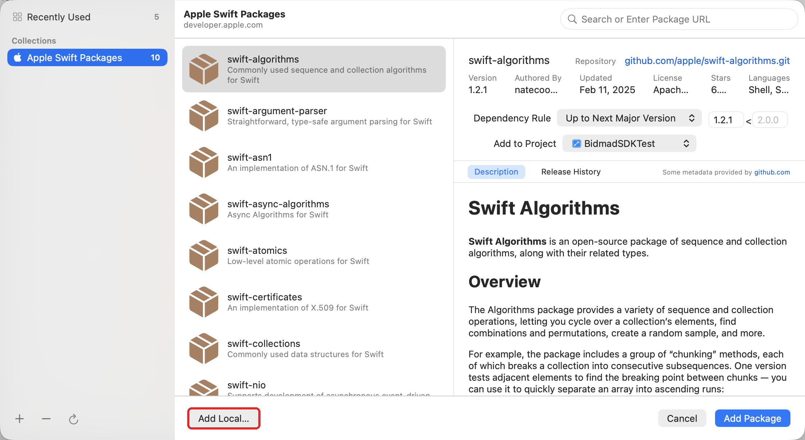
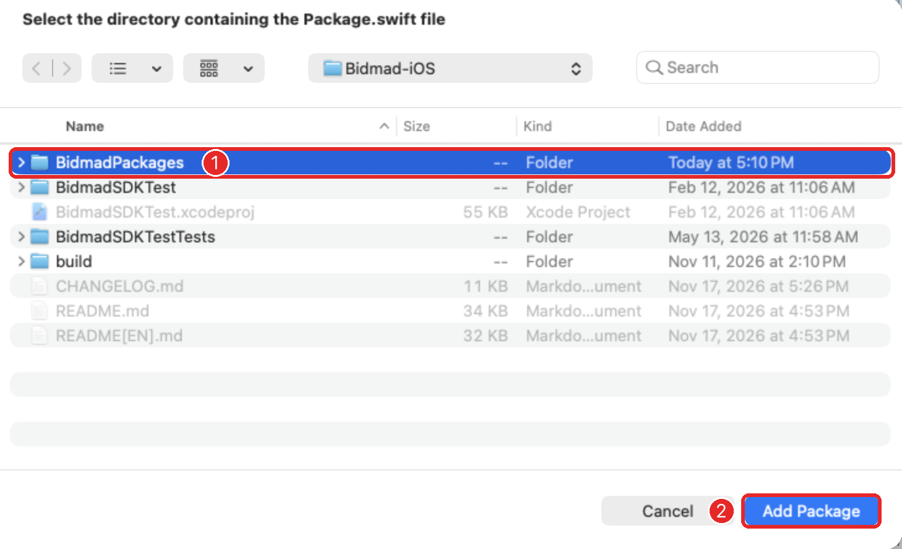
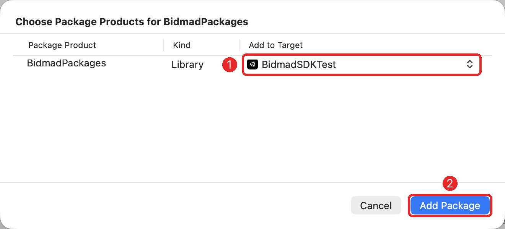
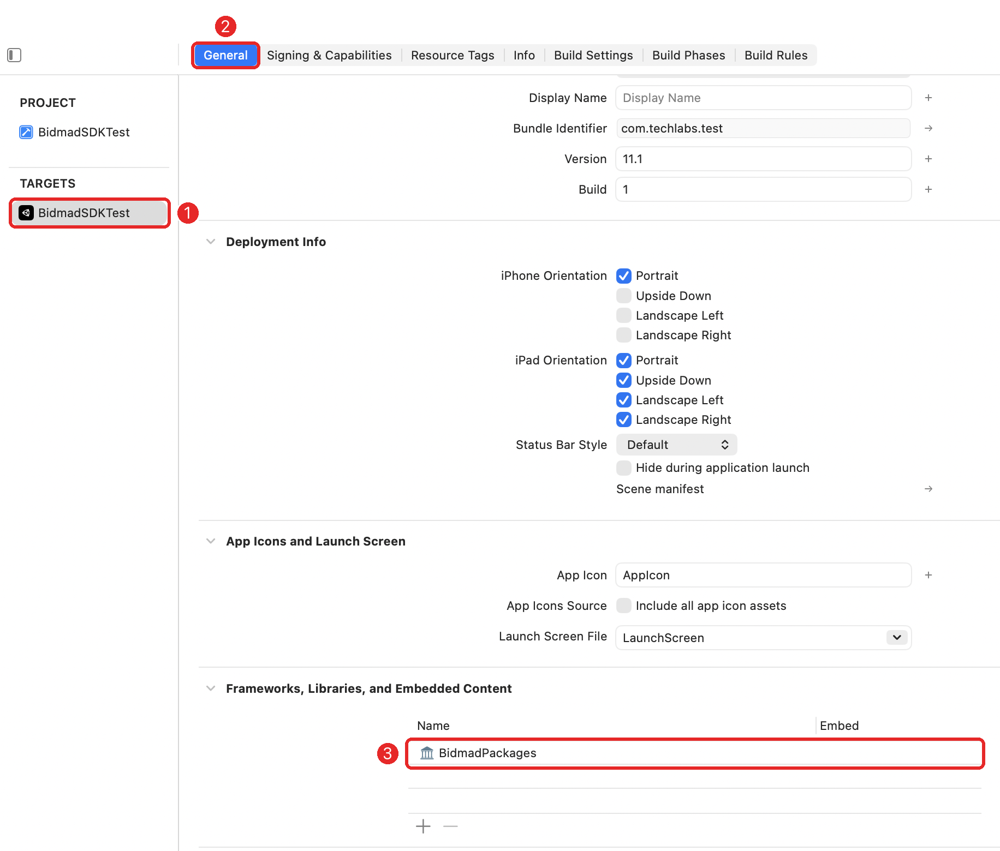
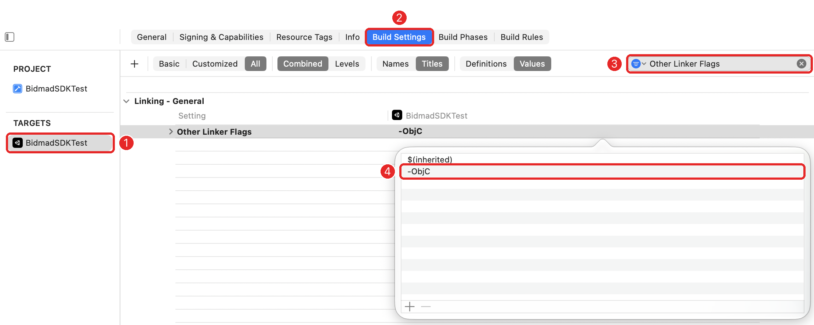
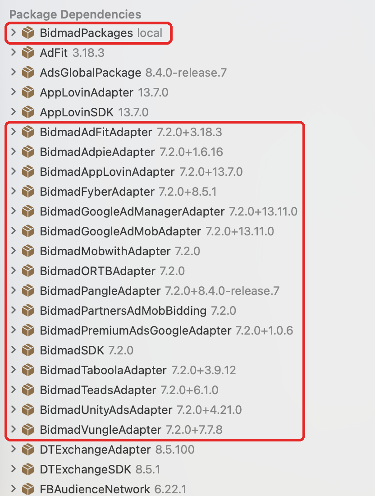
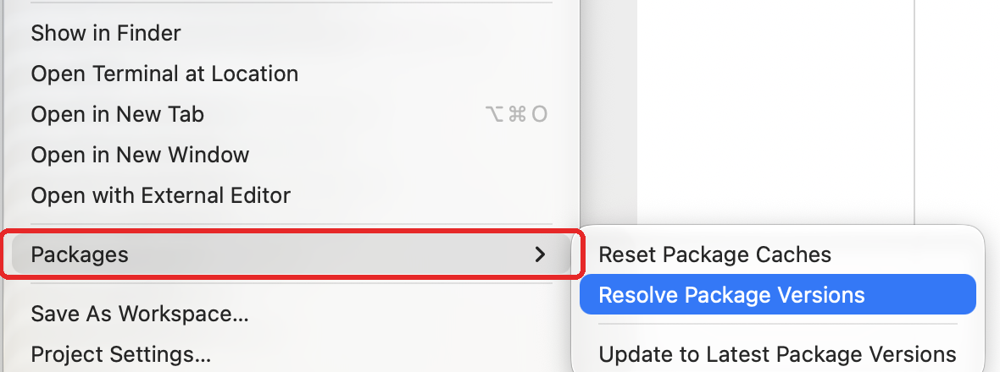

> [!IMPORTANT]
> BidmadSDK-iOS v6.11.0 부터 AppKey가 AppDomain으로 바뀌었습니다.<br>
> **SDK를 초기화하려면 새 AppDomain을 발급받아야 합니다.**<br>
> BidmadSDK-iOS v7.2.0 부터 **Swift Package Manager** 로만 배포됩니다.<br>
> BidmadSDK-iOS v7.2.0 부터 iOS 15.0 이상을 요구합니다.

# BidmadSDK
### 바로가기
1. [SDK 세팅](#bidmadsdk-installation-guide)
    - [개발 환경](#개발-환경)
    - [SDK 설치 방법](#sdk-설치-방법)
    - [버전 업데이트](#버전-업데이트)
2. [SDK 인터페이스 가이드](#bidmadsdk-interface-guide)
    - [앱 초기 구성 및 Migration](#앱-초기-구성-및-migration)
    - [BidmadSDK 초기화](#bidmadsdk-초기화)
    - [배너 광고](#배너-광고)
    - [전면 광고](#전면-광고)
    - [보상형 비디오 광고](#보상형-비디오-광고)
    - [전체화면 광고](#전체화면-광고)
    - [App Open 광고](#app-open-광고)
    - [Native Ad 광고](#native-ad-광고)
    - [구글 애드네트워크 테스트 디바이스 설정](#구글-애드네트워크-테스트-디바이스-설정)
3. [참고사항](#참고사항)
4. [최신 샘플 프로젝트 다운로드](https://github.com/bidmad/Bidmad-iOS/archive/refs/heads/main.zip)
---

## BidmadSDK Installation Guide

#### 개발 환경
- Xcode 최소 사양 26.0
- iOS Deployment Target : 15.0

#### SDK 설치 방법
BidmadSDK 7.2.0 부터 **Swift Package Manager(SPM)** 로만 배포됩니다.<br>
아래 순서에 따라 필요한 의존성을 한 번에 추가할 수 있습니다. 샘플 저장소의 [`BidmadPackages`](./BidmadPackages) 폴더를 복사해 사용해도 됩니다.

> [!NOTE]
> SPM 연동 전에 Bidmad 의 CocoaPods 설치를 모두 제거해 주십시오.

1. 다음 이미지처럼 폴더와 파일을 만듭니다.
    - `BidmadPackages` > `Package.swift`
    - `BidmadPackages` > `Sources` > `BidmadPackages` > `BidmadPackages.swift`

    

    - `BidmadPackages.swift` 는 내용을 비워 두어도 되지만, 파일은 반드시 있어야 합니다. **이 파일들은 앱 타깃에 추가하지 마십시오.**<br>
      

2. `Package.swift` 에 다음 내용을 작성합니다.

    ```swift
    // swift-tools-version:5.9
    import PackageDescription

    let bidmad: [(repository: String, version: Version, products: [String])] = [
        ("BidmadSDK-SPM",                     "7.2.0",                 ["BidmadSDK", "OpenBiddingHelper", "BidmadGoogleGDPRAdapter"]),
        ("BidmadGoogleAdMobAdapter-SPM",      "7.2.0+13.11.0",         ["BidmadGoogleAdMobAdapter"]),
        ("BidmadGoogleAdManagerAdapter-SPM",  "7.2.0+13.11.0",         ["BidmadGoogleAdManagerAdapter"]),
        ("BidmadAppLovinAdapter-SPM",         "7.2.0+13.7.0",          ["BidmadAppLovinAdapter"]),
        ("BidmadUnityAdsAdapter-SPM",         "7.2.0+4.21.0",          ["BidmadUnityAdsAdapter"]),
        ("BidmadPangleAdapter-SPM",           "7.2.0+8.4.0-release.7", ["BidmadPangleAdapter"]),
        ("BidmadFyberAdapter-SPM",            "7.2.0+8.5.1",           ["BidmadFyberAdapter"]),
        ("BidmadVungleAdapter-SPM",           "7.2.0+7.7.8",           ["BidmadVungleAdapter"]),
        ("BidmadTeadsAdapter-SPM",            "7.2.0+6.1.0",           ["BidmadTeadsAdapter"]),
        ("BidmadAdFitAdapter-SPM",            "7.2.0+3.18.3",          ["BidmadAdFitAdapter"]),
        ("BidmadAdpieAdapter-SPM",            "7.2.0+1.6.16",          ["BidmadAdpieAdapter"]),
        ("BidmadTaboolaAdapter-SPM",          "7.2.0+3.9.12",          ["BidmadTaboolaAdapter"]),
        ("BidmadPremiumAdsGoogleAdapter-SPM", "7.2.0+1.0.6",           ["BidmadPremiumAdsGoogleAdapter"]),
        ("BidmadMobwithAdapter-SPM",          "7.2.0",                 ["BidmadMobwithAdapter"]),
        ("BidmadORTBAdapter-SPM",             "7.2.0",                 ["BidmadORTBAdapter"]),
        ("BidmadPartnersAdMobBidding-SPM",    "7.2.0",                 ["BidmadPartnersAdMobBidding", "BidmadPartnersAdMobBiddingDynamicSDKs"]),
    ]

    let package = Package(
        name: "BidmadPackages",
        platforms: [.iOS(.v15)],
        products: [.library(name: "BidmadPackages", targets: ["BidmadPackages"])],
        dependencies: bidmad.map { .package(url: "https://github.com/bidmad/\($0.repository).git", exact: $0.version) },
        targets: [
            .target(
                name: "BidmadPackages",
                dependencies: bidmad.flatMap { entry in entry.products.map { .product(name: $0, package: entry.repository) } }
            )
        ]
    )
    ```

3. Xcode 메뉴에서 **File › Add Package Dependencies…** 를 선택합니다.<br>
    

4. 창 아래의 **Add Local…** 을 누르고 `BidmadPackages` 폴더를 선택합니다.<br>
    <br>
    

5. `BidmadPackages` 제품을 앱 타깃에 추가합니다 (**Add to Target** 에서 앱 타깃 선택 후 **Add Package**).<br>
    <br>
    추가되면 타깃의 **General › Frameworks, Libraries, and Embedded Content** 에 `BidmadPackages` 가 보입니다.<br>
    

6. **Build Settings › Other Linker Flags** 에 `-ObjC` 를 추가합니다.<br>
    

7. 빌드합니다. 프로젝트 네비게이터의 **Package Dependencies** 에서 각 패키지가 지정한 버전으로 받아졌는지 확인할 수 있습니다.<br>
    

#### 버전 업데이트
`BidmadPackages/Package.swift` 에서 바꿀 패키지의 버전만 고친 뒤, **File › Packages › Resolve Package Versions** 를 실행합니다. 각 릴리스의 변경 내역은 [CHANGELOG.md](./CHANGELOG.md) 를 참고하십시오.<br>


#### 앱 제출 및 개인정보 보호 설문조사
App Store에 애플리케이션을 제출할 때 다음 가이드를 참고하여 개인 정보 보호 정책 및 설문조사를 올바르게 설정하세요. [Guide for Privacy Manifest & Privacy Survey](https://github.com/bidmad/Bidmad-iOS/wiki/Guide-for-Privacy-Manifest-&-Privacy-Survey-%5BKR%5D)

## BidmadSDK Interface Guide

### 앱 초기 구성 및 Migration<br>
이전 버전에서 업데이트하는 경우, 해당하는 항목을 확인하십시오.

| 업데이트 | 변경 사항 | 참고 |
|---|---|---|
| 7.2.0 | CocoaPods → Swift Package Manager, iOS 15.0 이상 | [SDK 설치 방법](#sdk-설치-방법) |
| 7.0.0 | iOS 14.0 이상, 광고 네트워크 SDK 갱신 | [CHANGELOG.md](./CHANGELOG.md) |
| 6.14.0 미만 → 6.14.0 이상 | Banner / AppOpen / NativeAd 델리게이트 시그니처 변경 | [CHANGELOG.md](./CHANGELOG.md) |
| 6.3.5 이하 → 6.4.0 이상 | 앱오픈 / 네이티브 광고 인터페이스 변경 | [Migration Guide](https://github.com/bidmad/Bidmad-iOS/wiki/AppOpen-and-NativeAd-Migration-Guide-for-6.4.0-%5BKOR%5D) |
| 5.3.0 이하 → 6.0.0 이상 | 네이티브 광고 인터페이스 변경 | [Migration Guide](https://github.com/bidmad/Bidmad-iOS/wiki/Native-Ad-Migration-to-v6.0.0%5BKOR%5D) |
| 4.6.0.1 이하 → 5.0.0 | API 변경 | [Migration Guide](https://github.com/bidmad/Bidmad-iOS/wiki/v5.0.0-API-Migration-Guide-%5BKR%5D) |

1. Techlabs 운영팀으로부터 전달받은 AppDomain 값을 다음과 같이 info.plist에 기입하십시오.<br>

```
<key>BidmadAppDomain</key>
<string>**YOUR-APP-DOMAIN**</string>
```

2. AdMob 대시보드 UI에서 확인 가능한 iOS 용 애드몹 ID ("[App Key 찾기](https://github.com/bidmad/SDK/wiki/Find-your-app-key%5BKR%5D)" 가이드를 참고하십시오) <br>

```
<key>GADApplicationIdentifier</key>
<string>ca-app-pub-xxxxxxxxxxxxxxxx~xxxxxxxxxx</string>
```

3. BidmadSDK에서 지원하는 광고 네트워크에 대한 SKAdNetworkIdentifier 값이 포함된 SKAdNetworkItems 키 ([Preparing for iOS 14](https://github.com/bidmad/Bidmad-iOS/wiki/Preparing-for-iOS-14%5BKOR%5D) 를 참고하십시오)<br>

```
<key>SKAdNetworkItems</key>
<array>
    <dict>
        <key>SKAdNetworkIdentifier</key>
        <string>xxxxxxxxxx.skadnetwork</string>
        ...
    </dict>
</array>
```

### BidmadSDK 초기화<br>
BidmadSDK 실행에 필요한 작업을 수행합니다. SDK는 initializeSdk 메서드를 호출하지 않은 경우 광고 로드를 허용하지 않습니다.<br>
초기화는 앱 실행 시 한번만 하는 것이 좋습니다. 다음은 initializeSdk 메서드를 호출하는 방법의 예시입니다.<br>

```
// Objective C
[BidmadCommon initializeSdk];

// -- SWIFT --
BidmadCommon.initializeSdk()
```

또한, 아래 인터페이스를 통해 initializeSdk 성공 여부 콜백을 전달받을 수 있습니다.<br>

```
// Objective C
[BidmadCommon initializeSdkWithCompletionHandler:^(BOOL isInitialized) {
    NSLog(@"Bidmad Sample App: Initialized %@", isInitialized ? @"YES" : @"NO");
}];

// -- SWIFT --
BidmadCommon.initializeSdk { isInitialized in
    print("Bidmad Sample App: \(isInitialized)")
}
```

### 배너 광고
1. 배너를 노출시킬 UIView를 UIViewController 상에 추가합니다 (UIView bannerContainer).
2. 배너 Initialize / ZoneID / Delegate 세팅 후, RequestBannerView를 호출해 배너를 로드 및 노출시킵니다.

<details markdown="1">
<summary>Sample Code (Load)</summary>
<br>

```
// Objective C

@import OpenBiddingHelper;

@interface BannerViewController : UIViewController<BidmadBannerAdDelegate> {
    BidmadBannerAd *bannerAd;
}
__weak IBOutlet UIView *bannerContainer;
@end

@implementation BannerViewController

- (void)viewDidLoad {

    // Please set the Zone ID before calling a banner ad.
    NSString *zoneID = @"XXXXXXXX-XXXX-XXXX-XXXX-XXXXXXXXXXXX";
    bannerAd = [[BidmadBannerAd alloc] initWith:self containerView:self.BannerContainer zoneID:zoneID];
    bannerAd.delegate = self;
    [bannerAd setRefreshInterval:[@60 integerValue]];
    
    [bannerAd load];
}

// -- SWIFT --

import OpenBiddingHelper

class BannerViewController: UIViewController, BidmadBannerAdDelegate {
    var bannerAd: BidmadBannerAd!
    @IBOutlet weak var bannerContainer: UIView!
    
    override func viewDidLoad() {
        super.viewDidLoad()
        
        bannerAd = BidmadBannerAd(self, containerView: bottomView, zoneID: "XXXXXXXX-XXXX-XXXX-XXXX-XXXXXXXXXXXX")
        bannerAd.delegate = self
        bannerAd.setRefreshInterval(60)
        bannerAd.load()
    }
}
```
</details>

<details markdown="1">
<summary>Sample Code (Callback)</summary>
<br>

```
// Objective C

- (void)onLoadBannerAd:(BidmadBannerAd *)bannerAd info:(BidmadInfo *)info {
    NSLog(@"Load")
}

- (void)onClickBannerAd:(BidmadBannerAd *)bannerAd info:(BidmadInfo *)info {
    NSLog(@"Click")
}

- (void)onLoadFailBannerAd:(BidmadBannerAd *)bannerAd error:(NSError *)error {
    NSLog(@"LoadFail")
}

// -- SWIFT --

func onLoad(bannerAd: BidmadBannerAd, info: BidmadInfo) {
    print("ad is loaded")
}

func onLoadFail(bannerAd: BidmadBannerAd, error: any Error) {
    print("ad failed to load with error \(error.localizedDescription)")
}

func onClick(bannerAd: BidmadBannerAd, info: BidmadInfo) {
    print("ad is clicked")
}
```
</details>

### 전면 광고
1. 전면 광고를 노출시키기 전, load 메서드를 호출합니다.
2. onLoadAd 콜백 수신 이후, show(on:) 메서드를 호출해 미리 로드된 전면 광고를 디스플레이 합니다. 

<details markdown="1">
<summary>Sample Code (Load)</summary>
<br>

```
// Objective C

@import OpenBiddingHelper;

@interface InterstitialViewController () <BIDMADOpenBiddingInterstitialDelegate> {
    BidmadInterstitialAd *interstitialAd;
}
@end

@implementation InterstitialViewController
- (void)viewDidLoad {
    
    NSString *zoneID = @"xxxxxxxx-xxxx-xxxx-xxxx-xxxxxxxxxxxx";
    interstitialAd = [[BidmadInterstitialAd alloc] initWithZoneID:zoneID];
    [interstitialAd setDelegate: self];
}

-(void)loadAd {
    [interstitialAd load];
}
...
-(void)showAd {
    [interstitialAd showOnViewController:self];
}

// -- SWIFT --

import OpenBiddingHelper

class InterstitialController: UIViewController, BIDMADOpenBiddingInterstitialDelegate {
    static let interstitialZoneID = "xxxxxxxx-xxxx-xxxx-xxxx-xxxxxxxxxxxx"
    let interstitialAd = BidmadInterstitialAd(zoneID: interstitialZoneID)
   
    override func viewDidLoad() {
        super.viewDidLoad()
        
        interstitialAd.delegate = self
    }
  
    func loadAd() {
        interstitialAd.load()
    }

    func showAd() {
        interstitialAd.show(on: self)
    }
}
```
</details>

<details markdown="1">
<summary>Sample Code (Callback)</summary>
<br>

```
// Objective C

- (void)onLoadAd:(OpenBiddingInterstitial *)bidmadAd info:(BidmadInfo *)info {
    NSLog(@"Load");
}

- (void)onLoadFailAd:(OpenBiddingInterstitial *)bidmadAd error:(NSError *)error {
    NSLog(@"Load Fail");
}

- (void)onShowAd:(OpenBiddingInterstitial *)bidmadAd info:(BidmadInfo *)info {
    NSLog(@"Show");
}

- (void)onClickAd:(OpenBiddingInterstitial *)bidmadAd info:(BidmadInfo *)info {
    NSLog(@"Click");
}

- (void)onCloseAd:(OpenBiddingInterstitial *)bidmadAd info:(BidmadInfo *)info {
    NSLog(@"Close");
}

// onShowFailAd:error: 콜백은 v6.6.0 이상에서만 사용할 수 있습니다.
- (void)onShowFailAd:(OpenBiddingInterstitial *)bidmadAd info:(BidmadInfo *)info error:(NSError *)error {
    NSLog(@"Show Fail");
}

// -- SWIFT --

func onLoadAd(_ bidmadAd: OpenBiddingInterstitial, info: BidmadInfo) {
    print("ad is loaded")
}

func onLoadFailAd(_ bidmadAd: OpenBiddingInterstitial, error: any Error) {
    print("ad failed to load with error \(error.localizedDescription)")
}

func onShowAd(_ bidmadAd: OpenBiddingInterstitial, info: BidmadInfo) {
    print("ad is shown")
}

func onClickAd(_ bidmadAd: OpenBiddingInterstitial, info: BidmadInfo) {
    print("ad is clicked")
}

func onCloseAd(_ bidmadAd: OpenBiddingInterstitial, info: BidmadInfo) {
    print("ad is closed")
}

// onShowFailAd:error: 콜백은 v6.6.0 이상에서만 사용할 수 있습니다.
func onShowFailAd(_ bidmadAd: OpenBiddingInterstitial,, info: BidmadInfo, error: Error) {
    print("ad display failed")
}
```
</details>

### 보상형 비디오 광고
1. 보상형 광고를 노출시키기 전, load 메서드를 호출합니다.
2. onLoadAd 콜백 수신 이후, show(on:) 메서드를 호출해 미리 로드된 보상형 광고를 디스플레이 합니다.
3. onSkipAd (사용자가 광고를 스킵함) 혹은 onCompleteAd (사용자가 보상 지급 자격을 받음) 콜백에 따라 사용자에게 보상을 지급합니다.

<details markdown="1">
<summary>Sample Code (Load)</summary>
<br>

```
// Objective C
@import OpenBiddingHelper;

@interface RewardViewController () <BIDMADOpenBiddingRewardVideoDelegate> {
    BidmadRewardAd *rewardAd;
}
@end

@implementation RewardViewController

- (void)viewDidLoad {
    
    NSString *zoneID = @"xxxxxxxx-xxxx-xxxx-xxxx-xxxxxxxxxxxx";
    rewardAd = [[BidmadRewardAd alloc] initWithZoneID:zoneID];
    rewardAd.delegate = self;
}

-(void)loadReward {
    [rewardAd load];
}
   

-(void)showReward {
    [rewardAd showOnViewController:self];
}

// -- SWIFT --

import OpenBiddingHelper

class RewardVideoController: UIViewController, BIDMADOpenBiddingRewardVideoDelegate {
    static let rewardZoneID = "xxxxxxxx-xxxx-xxxx-xxxx-xxxxxxxxxxxx"
    let rewardAd = BidmadRewardAd(zoneID: rewardZoneID)

    override func viewDidLoad() {
        super.viewDidLoad()
    
        rewardAd.delegate = self
    }
    
    func loadAd() {
        rewardAd.load()
    }
  
    func showAd() {
        rewardAd.show(on: self)
    }
}
```
</details>

<details markdown="1">
<summary>Sample Code (Callback)</summary>
<br>

```
// Objective C

- (void)onLoadAd:(OpenBiddingRewardVideo *)bidmadAd info:(BidmadInfo *)info {
    NSLog(@"Load");
}

- (void)onLoadFailAd:(OpenBiddingRewardVideo *)bidmadAd error:(NSError *)error {
    NSLog(@"Load Fail");
}

- (void)onShowAd:(OpenBiddingRewardVideo *)bidmadAd info:(BidmadInfo *)info {
    NSLog(@"Show");
}

- (void)onClickAd:(OpenBiddingRewardVideo *)bidmadAd info:(BidmadInfo *)info {
    NSLog(@"Click");
}

- (void)onCompleteAd:(OpenBiddingRewardVideo *)bidmadAd info:(BidmadInfo *)info {
    NSLog(@"Complete");
}

- (void)onSkipAd:(OpenBiddingRewardVideo *)bidmadAd info:(BidmadInfo *)info {
    NSLog(@"Skip");
}

- (void)onCloseAd:(OpenBiddingRewardVideo *)bidmadAd info:(BidmadInfo *)info {
    NSLog(@"Close");
}

// onShowFailAd:error: 콜백은 v6.6.0 이상에서만 사용할 수 있습니다.
- (void)onShowFailAd:(OpenBiddingRewardVideo *)bidmadAd info:(BidmadInfo *)info error:(NSError *)error {
    NSLog(@"Show Fail");
}

// -- SWIFT --

func onLoadAd(_ bidmadAd: OpenBiddingRewardVideo, info: BidmadInfo) {
    print("ad is loaded")
}

func onLoadFailAd(_ bidmadAd: OpenBiddingRewardVideo, error: Error) {
    print("ad failed to load with error \(error.localizedDescription)")
}

func onShowAd(_ bidmadAd: OpenBiddingRewardVideo, info: BidmadInfo) {
    print("ad is shown")
}

func onClickAd(_ bidmadAd: OpenBiddingRewardVideo, info: BidmadInfo) {
    print("ad is clicked")
}

func onCompleteAd(_ bidmadAd: OpenBiddingRewardVideo, info: BidmadInfo) {
    print("ad reward is completed")
}

func onSkipAd(_ bidmadAd: OpenBiddingRewardVideo, info: BidmadInfo) {
    print("ad reward is skipped")
}

func onCloseAd(_ bidmadAd: OpenBiddingRewardVideo, info: BidmadInfo) {
    print("ad is closed")
}

// onShowFailAd:error: 콜백은 v6.6.0 이상에서만 사용할 수 있습니다.
func onShowFailAd(_ bidmadAd: OpenBiddingRewardVideo, info: BidmadInfo, error: Error) {
    print("ad display failed")
}
```
</details>

### 전체화면 광고
전면 광고와 보상형 광고를 하나의 클래스(`BidmadFullscreenAd`)로 사용할 수 있는 광고 형식입니다. v7.1.0 이상에서 사용할 수 있습니다.

1. 광고를 노출시키기 전, load 메서드를 호출합니다.
2. bidmadFullscreenLoad 콜백 수신 이후, show(on:) 메서드를 호출해 미리 로드된 광고를 디스플레이 합니다.
3. bidmadFullscreenComplete (사용자가 보상 지급 자격을 받음) 혹은 bidmadFullscreenSkip (사용자가 광고를 스킵함) 콜백에 따라 사용자에게 보상을 지급합니다.

`isAutoReload` 프로퍼티를 통해 광고 노출 이후의 자동 재로드 여부를 설정할 수 있습니다. 기본값은 `true` 입니다.

<details markdown="1">
<summary>Sample Code (Load)</summary>
<br>

```
// Objective C

#import <OpenBiddingHelper/OpenBiddingHelper.h>

@interface FullscreenAdViewController () <BidmadFullscreenAdDelegate>
@property (nonatomic, strong) BidmadFullscreenAd *ad;
@end

@implementation FullscreenAdViewController

- (void)viewDidLoad {
    [super viewDidLoad];

    NSString *zoneID = @"xxxxxxxx-xxxx-xxxx-xxxx-xxxxxxxxxxxx";
    self.ad = [[BidmadFullscreenAd alloc] initWithZoneID:zoneID];
    [self.ad setDelegate:self];

    // 광고 노출 이후 자동 재로드를 사용하지 않으려면 NO 로 설정합니다. (기본값 YES)
    [self.ad setIsAutoReload:YES];
}

- (void)loadAd {
    [self.ad load];
}

- (void)showAd {
    [self.ad showOn:self];
}

@end

// -- SWIFT --

import OpenBiddingHelper

class FullscreenAdViewController: UIViewController, BidmadFullscreenAdDelegate {
    let fullscreenZoneID = "xxxxxxxx-xxxx-xxxx-xxxx-xxxxxxxxxxxx"
    var ad: BidmadFullscreenAd!

    override func viewDidLoad() {
        super.viewDidLoad()

        ad = BidmadFullscreenAd(zoneID: fullscreenZoneID)
        ad.delegate = self

        // 광고 노출 이후 자동 재로드를 사용하지 않으려면 false 로 설정합니다. (기본값 true)
        ad.isAutoReload = true
    }

    func loadAd() {
        ad.load()
    }

    func showAd() {
        ad.show(on: self)
    }
}
```
</details>

<details markdown="1">
<summary>Sample Code (Callback)</summary>
<br>

```
// Objective C

- (void)bidmadFullscreenLoadWithAd:(BidmadFullscreenAd *)ad info:(BidmadInfo *)info {
    NSLog(@"Load");
}

- (void)bidmadFullscreenLoadFailWithAd:(BidmadFullscreenAd *)ad error:(NSError *)error {
    NSLog(@"Load Fail");
}

- (void)bidmadFullscreenShowWithAd:(BidmadFullscreenAd *)ad info:(BidmadInfo *)info {
    NSLog(@"Show");
}

- (void)bidmadFullscreenShowFailWithAd:(BidmadFullscreenAd *)ad info:(BidmadInfo *)info error:(NSError *)error {
    NSLog(@"Show Fail");
}

- (void)bidmadFullscreenClickWithAd:(BidmadFullscreenAd *)ad info:(BidmadInfo *)info {
    NSLog(@"Click");
}

- (void)bidmadFullscreenSkipWithAd:(BidmadFullscreenAd *)ad info:(BidmadInfo *)info {
    NSLog(@"Skip");
}

- (void)bidmadFullscreenCompleteWithAd:(BidmadFullscreenAd *)ad info:(BidmadInfo *)info {
    // 보상형 광고에서는 보상 조건 충족 시, 전면 광고에서는 광고가 닫힐 때 호출됩니다.
    NSLog(@"Complete");
}

- (void)bidmadFullscreenCloseWithAd:(BidmadFullscreenAd *)ad info:(BidmadInfo *)info {
    NSLog(@"Close");
}

// -- SWIFT --

func bidmadFullscreenLoad(ad: BidmadFullscreenAd, info: BidmadInfo) {
    print("ad is loaded")
}

func bidmadFullscreenLoadFail(ad: BidmadFullscreenAd, error: any Error) {
    print("ad failed to load with error \(error.localizedDescription)")
}

func bidmadFullscreenShow(ad: BidmadFullscreenAd, info: BidmadInfo) {
    print("ad is shown")
}

func bidmadFullscreenShowFail(ad: BidmadFullscreenAd, info: BidmadInfo?, error: any Error) {
    print("ad display failed")
}

func bidmadFullscreenClick(ad: BidmadFullscreenAd, info: BidmadInfo) {
    print("ad is clicked")
}

func bidmadFullscreenSkip(ad: BidmadFullscreenAd, info: BidmadInfo) {
    print("ad reward is skipped")
}

func bidmadFullscreenComplete(ad: BidmadFullscreenAd, info: BidmadInfo) {
    // 보상형 광고에서는 보상 조건 충족 시, 전면 광고에서는 광고가 닫힐 때 호출됩니다.
    print("ad reward is completed")
}

func bidmadFullscreenClose(ad: BidmadFullscreenAd, info: BidmadInfo) {
    print("ad is closed")
}
```
</details>

### App Open 광고
App Open 광고는 사용자가 앱을 포그라운드로 가져올 때, 앱 로드 화면으로 수익을 올리는 광고 형식입니다. App Open 광고는 사용자가 해당 앱을 사용 중임을 알 수 있도록 상단에 앱 로고를 표기합니다. BidmadSDK는 더 쉬운 App Open 광고 로드를 위해 BidmadAppOpenAd init 시, 바로 AppOpenAd를 로드합니다. 사용자가 앱을 닫고 다시 열어 광고를 시청한 이후에도, 다시 AppOpenAd 광고를 로드합니다.

<details markdown="1">
<summary>Sample Code (Load)</summary>
<br>

```
// Objective C

@interface AppOpenAdViewController () <BidmadAppOpenAdDelegate>
@property (nonatomic, strong) BidmadAppOpenAd *appOpenAd;
@end

@implementation AppOpenAdViewController

- (void)viewDidLoad {
    [super viewDidLoad];
    
    self.appOpenAd = [[BidmadAppOpenAd alloc] initWithZoneID:@"0ddd6401-0f19-49ee-b1f9-63e910f92e77"];
    [self.appOpenAd setDelegate: self];
}

- (void)loadAd {
    [self.appOpenAd load];
}

- (void)showAd {
    if ([self.appOpenAd isLoaded]) {
        [self.appOpenAd showOnViewController:self];
    }
}

@end

// -- SWIFT --

import OpenBiddingHelper

class AppOpenAdViewController: UIViewController, BidmadAppOpenAdDelegate {
    let appOpenAdZoneID = "xxxxxxxx-xxxx-xxxx-xxxx-xxxxxxxxxxxx"
    var appOpenAd: BidmadAppOpenAd!
    
    override func viewDidLoad() {
        super.viewDidLoad()
        
        appOpenAd = BidmadAppOpenAd(zoneID: appOpenAdZoneID)
        appOpenAd.delegate = self
    }
    
    func loadAppOpenAd() {
        appOpenAd.load()
    }
    
    func showAppOpenAd() {
        if appOpenAd.isLoaded() {
            appOpenAd.show(on: self)
        }
    }
}
```
</details>

<details markdown="1">
<summary>Sample Code (Callback)</summary>
<br>

```
- (void)onLoadAppOpenAd:(BidmadAppOpenAd *)appOpenAd info:(BidmadInfo *)info {
    NSLog(@"Load");
}

- (void)onShowAppOpenAd:(BidmadAppOpenAd *)appOpenAd info:(BidmadInfo *)info {
    NSLog(@"Show");
}

- (void)onClickAppOpenAd:(BidmadAppOpenAd *)appOpenAd info:(BidmadInfo *)info {
    NSLog(@"Click");
}

- (void)onCloseAppOpenAd:(BidmadAppOpenAd *)appOpenAd info:(BidmadInfo *)info {
    NSLog(@"Close");
}

- (void)onLoadFailAppOpenAd:(BidmadAppOpenAd *)appOpenAd error:(NSError *)error {
    NSLog(@"Load Fail");
}

- (void)onShowFailAppOpenAd:(BidmadAppOpenAd *)appOpenAd info:(BidmadInfo *)info error:(NSError *)error {
    NSLog(@"Show Fail");
}

// -- SWIFT --

func onLoad(appOpenAd: BidmadAppOpenAd, info: BidmadInfo) {
    print("ad is loaded")
}

func onLoadFail(appOpenAd: BidmadAppOpenAd, error: Error) {
    print("ad failed to load with error \(error.localizedDescription)")
}

func onShow(appOpenAd: BidmadAppOpenAd, info: BidmadInfo) {
    print("ad is shown")
}

func onClick(appOpenAd: BidmadAppOpenAd, info: BidmadInfo) {
    print("ad is clicked")
}

func onClose(appOpenAd: BidmadAppOpenAd, info: BidmadInfo) {
    print("ad is closed")
}

func onShowFail(appOpenAd: BidmadAppOpenAd, info: BidmadInfo, error: Error) {
    print("ad display failed")
}
```
</details>

### Native Ad 광고
네이티브 광고는 애플리케이션에 맞는 고유한 방식으로 기획, 제작된 광고를 말합니다. 광고를 호출하기 앞서, [레이아웃 가이드](https://github.com/bidmad/Bidmad-iOS/wiki/Native-Ad-Layout-Setting-Guide-%5BKOR%5D)에 따라 광고 UI 설정해주십시오. 광고 UI 설정 이후, 광고 데이터가 포함된 BIDMADNativeAd 를 로드한 뒤, setAdView:adView: 메서드를 실행합니다.

*5.3.0 버전 이하에서 6.0.0 버전 이상으로 업데이트하시는 네이티브 광고 인터페이스 사용자의 경우 [NativeAd Migration Guide 6.0.0](https://github.com/bidmad/Bidmad-iOS/wiki/Native-Ad-Migration-to-v6.0.0%5BKOR%5D) 를 참고해 앱 업데이트를 진행하십시오.

<details markdown="1">
<summary>Sample Code (Load & Callbacks)</summary>
<br>

```
// Objective C

@import OpenBiddingHelper; 

@interface NativeAdViewController ()
@property (strong, nonatomic) BidmadNativeAd * ad;
@end
...

- (void)viewDidLoad {
    self.ad = [BidmadNativeAd adWithZoneID:@"xxxxxxxx-xxxx-xxxx-xxxx-xxxxxxxxxxxx"];
    [self.ad setDelegate:self];
    [self.ad load];
}

#pragma mark Native Ad Delegate Methods

- (void)onClickNativeAd:(BidmadNativeAd *)nativeAd info:(BidmadInfo *)info {
    ADOPLog.printInfo(@"Native Ad Click");
}

- (void)onLoadNativeAd:(BidmadNativeAd *)nativeAd info:(BidmadInfo *)info {
    ADOPLog.printInfo(@"Native Ad Load);
    
    UIView *loadedView = [NSBundle.mainBundle loadNibNamed:@"NativeAdView" owner:nil options:nil].firstObject;
    BIDMADNativeAdView *adView = [BidmadNativeAd findAdViewFromSuperview:loadedView];
    
    [self.view addSubview:loadedView];
    [nativeAd setRootViewController:self adView:adView];
}

- (void)onLoadFailNativeAd:(BidmadNativeAd *)nativeAd error:(NSError *)error {
    ADOPLog.printInfo(@"Native Ad Fail: %@", error.localizedDescription);
}

// -- SWIFT --

let ad: BidmadNativeAd! = BidmadNativeAd(zoneID: "Native Ad Zone ID")

override func viewDidLoad() {
    super.viewDidLoad()

    self.ad.delegate = self
    self.ad.load()
}

// MARK: BidmadNativeAdDelegate

func onLoad(nativeAd: BidmadNativeAd, info: BidmadInfo) {
    if let loadedView = Bundle.main.loadNibNamed("NativeAd", owner: nil)?.first as? UIView,
       let adView = BidmadNativeAd.findView(fromSuperview: loadedView) {
        view.addSubview(loadedView)
        self.ad.setRootViewController(self, adView: adView)
    }
}

func onClick(nativeAd: BidmadNativeAd, info: BidmadInfo) {
    print("Native Ad Click")
}

func onLoadFail(nativeAd: BidmadNativeAd, error: any Error) {
    print("Native Ad Fail")
}
```
</details>

### 구글 애드네트워크 테스트 디바이스 설정
</details>
<details markdown="1">
<summary>세부사항</summary>
<br>

구글 애드네트워크를 위한 테스트 디바이스 설정은 다음과 같은 과정이 필요합니다.  

광고 통합 앱을 로드하고 광고를 요청합니다.
콘솔에서 다음과 같은 메시지를 확인합니다.

```
<Google> To get test ads on this device, set: GADMobileAds.sharedInstance.requestConfiguration.testDeviceIdentifiers = @[ @"xxxxxxxxxxxxxxxxxxxxxxxxxxxxxxxx" ];
```
콘솔에 기록된 테스트 디바이스 ID를 다음 코드를 통해 세팅하십시오.
```
// ObjC
[BidmadCommon setTestDeviceId:@"xxxxxxxxxxxxxxxxxxxxxxxxxxxxxxxx"];

// -- SWIFT --
BidmadCommon.setTestDeviceId("xxxxxxxxxxxxxxxxxxxxxxxxxxxxxxxx")
```

</details>

### 참고사항

</details>
<details markdown="1">
<summary>리스트</summary>
<br>

- [Class Reference for BidmadSDK-iOS](https://github.com/bidmad/Bidmad-iOS/wiki/README-ClassReference%5BKOR%5D)
- CocoaPods 설치 가이드 (7.1.1 이하) ([[ENG]](https://github.com/bidmad/Bidmad-iOS/wiki/CocoaPods-Installation-Guide-%5BENG%5D) | [[KOR]](https://github.com/bidmad/Bidmad-iOS/wiki/CocoaPods-Installation-Guide-%5BKOR%5D))
- Apple privacy survey ([[ENG]](https://github.com/bidmad/Bidmad-iOS/wiki/Apple-privacy-survey%5BENG%5D) | [[KOR]](https://github.com/bidmad/Bidmad-iOS/wiki/Apple-privacy-survey%5BKOR%5D))
- iOS GDPR Guide ([[ENG]](https://github.com/bidmad/Bidmad-iOS/wiki/iOS-GDPR-Guide-%5BENG%5D) | [[KOR]](https://github.com/bidmad/Bidmad-iOS/wiki/iOS-GDPR-Guide-%5BKOR%5D))
- Preparing for iOS 14 ([[ENG]](https://github.com/bidmad/Bidmad-iOS/wiki/Preparing-for-iOS-14%5BENG%5D) | [[KOR]](https://github.com/bidmad/Bidmad-iOS/wiki/Preparing-for-iOS-14%5BKOR%5D))
- [쿠팡 네트워크 광고 차단 인터페이스 가이드](https://github.com/bidmad/Bidmad-iOS/wiki/쿠팡-네트워크-광고-차단-인터페이스-가이드)
</details>

