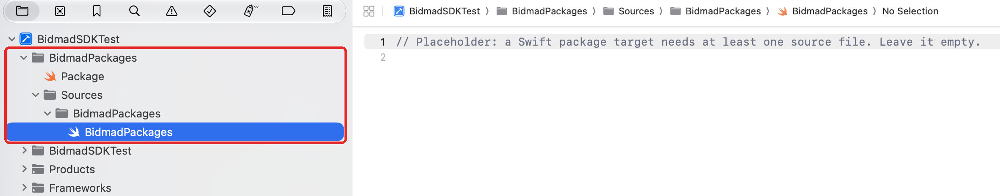
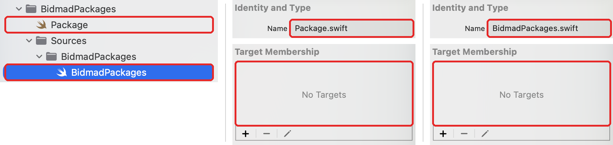
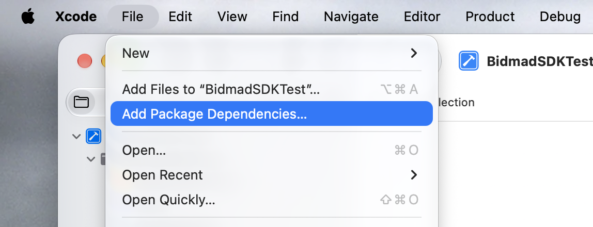
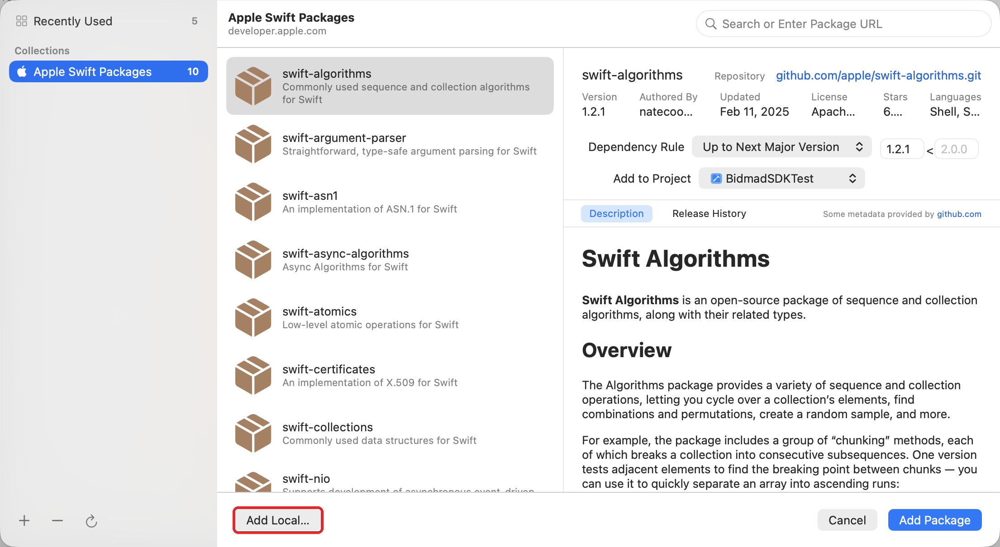
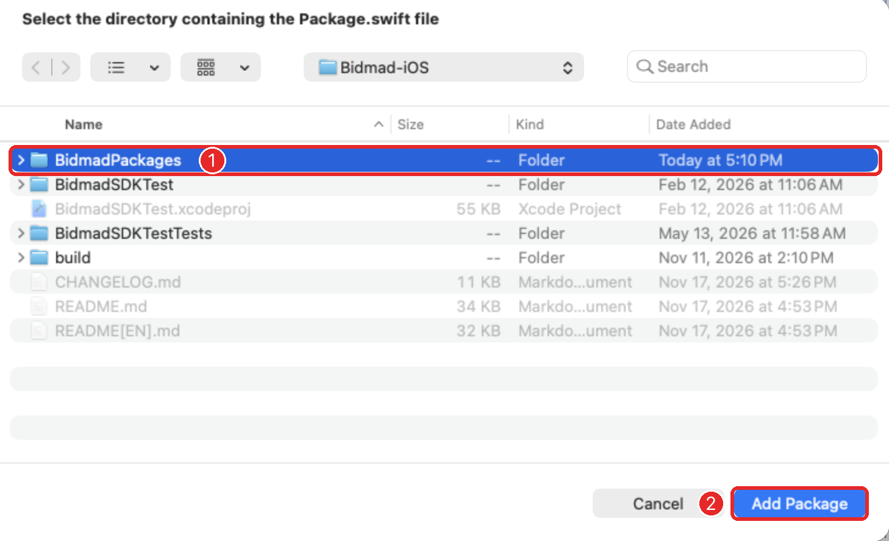
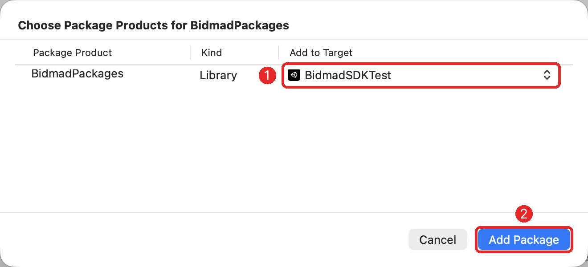
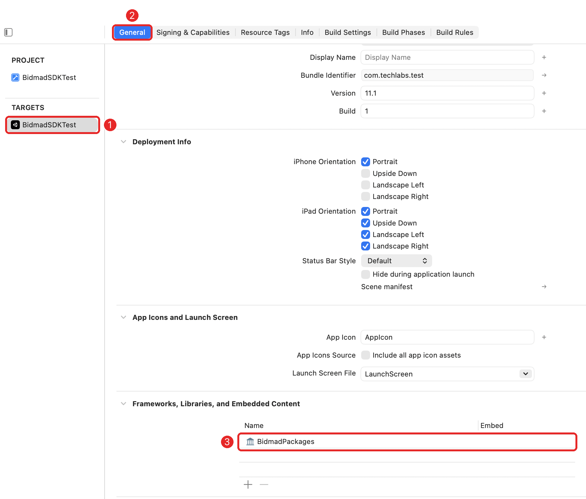
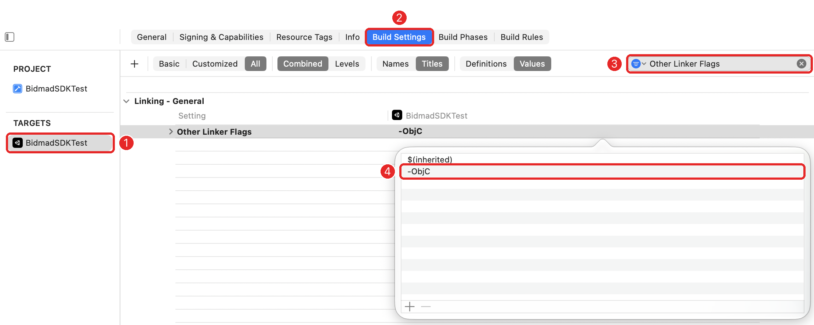
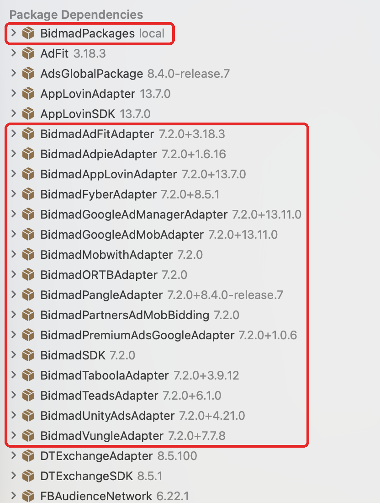
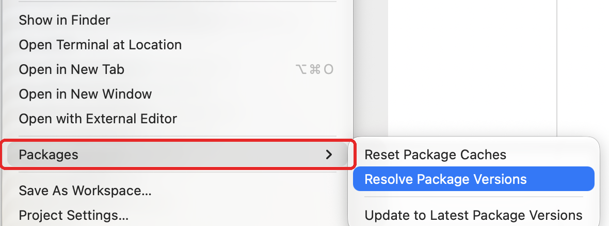

> [!IMPORTANT]
> From v6.11.0, AppKey is replaced by AppDomain.<br>
> **Get a new AppDomain to initialize BidmadSDK.**<br>
> From v7.2.0, BidmadSDK uses **Swift Package Manager** only.<br>
> From v7.2.0, BidmadSDK requires iOS 15.0 or later.

# BidmadSDK
### Shortcuts
1. [SDK Installation Guide](#bidmadsdk-installation-guide)
    - [Development Environment](#development-environment)
    - [SDK Installation Guide](#installation-guide)
    - [Updating Versions](#updating-versions)
2. [BidmadSDK Interface Guide](#bidmadsdk-interface-guide)
    - [App Configuration and Migration](#app-configuration-and-migration)
    - [BidmadSDK Initialization](#bidmadsdk-initialization)
    - [Banner Ad](#banner-ad)
    - [Interstitial Ad](#interstitial-ad)
    - [Rewarded Video Ads](#rewarded-video-ads)
    - [Fullscreen Ad](#fullscreen-ad)
    - [App Open Ad](#app-open-ad)
    - [Native Ad](#native-ad)
    - [Google Ad Network Test Device Setting](#google-ad-network-test-device-setting)
3. [References](#references)
4. [Download the Latest Bidmad Sample](https://github.com/bidmad/Bidmad-iOS/archive/refs/heads/main.zip)
---

## BidmadSDK Installation Guide

#### Development Environment
- Xcode minimum version of 26.0 required
- iOS Deployment Target : 15.0

#### Installation Guide
From 7.2.0, BidmadSDK ships through **Swift Package Manager (SPM)** only.<br>
The following steps add every dependency you need at once. You may also copy the [`BidmadPackages`](./BidmadPackages) folder from this sample repository.

> [!NOTE]
> Remove any CocoaPods installation of Bidmad before the SPM integration.

1. Create the folders and files as in the following image.
    - `BidmadPackages` > `Package.swift`
    - `BidmadPackages` > `Sources` > `BidmadPackages` > `BidmadPackages.swift`

    

    - `BidmadPackages.swift` can be left empty, but the file must exist. **Do not add these files to the app target.**<br>
      

2. Write the following in `Package.swift`.

    ```swift
    // swift-tools-version:5.9
    import PackageDescription

    let bidmad: [(repository: String, version: Version, products: [String])] = [
        ("BidmadSDK-SPM",                     "7.2.0",                 ["BidmadSDK", "OpenBiddingHelper", "BidmadGoogleGDPRAdapter"]),
        ("BidmadGoogleAdMobAdapter-SPM",      "7.2.0+13.11.0",         ["BidmadGoogleAdMobAdapter"]),
        ("BidmadGoogleAdManagerAdapter-SPM",  "7.2.0+13.11.0",         ["BidmadGoogleAdManagerAdapter"]),
        ("BidmadAppLovinAdapter-SPM",         "7.2.0+13.7.0",          ["BidmadAppLovinAdapter"]),
        ("BidmadUnityAdsAdapter-SPM",         "7.2.0+4.21.0",          ["BidmadUnityAdsAdapter"]),
        ("BidmadPangleAdapter-SPM",           "7.2.0+8.4.0-release.7", ["BidmadPangleAdapter"]),
        ("BidmadFyberAdapter-SPM",            "7.2.0+8.5.1",           ["BidmadFyberAdapter"]),
        ("BidmadVungleAdapter-SPM",           "7.2.0+7.7.8",           ["BidmadVungleAdapter"]),
        ("BidmadTeadsAdapter-SPM",            "7.2.0+6.1.0",           ["BidmadTeadsAdapter"]),
        ("BidmadAdFitAdapter-SPM",            "7.2.0+3.18.3",          ["BidmadAdFitAdapter"]),
        ("BidmadAdpieAdapter-SPM",            "7.2.0+1.6.16",          ["BidmadAdpieAdapter"]),
        ("BidmadTaboolaAdapter-SPM",          "7.2.0+3.9.12",          ["BidmadTaboolaAdapter"]),
        ("BidmadPremiumAdsGoogleAdapter-SPM", "7.2.0+1.0.6",           ["BidmadPremiumAdsGoogleAdapter"]),
        ("BidmadMobwithAdapter-SPM",          "7.2.0",                 ["BidmadMobwithAdapter"]),
        ("BidmadORTBAdapter-SPM",             "7.2.0",                 ["BidmadORTBAdapter"]),
        ("BidmadPartnersAdMobBidding-SPM",    "7.2.0",                 ["BidmadPartnersAdMobBidding", "BidmadPartnersAdMobBiddingDynamicSDKs"]),
    ]

    let package = Package(
        name: "BidmadPackages",
        platforms: [.iOS(.v15)],
        products: [.library(name: "BidmadPackages", targets: ["BidmadPackages"])],
        dependencies: bidmad.map { .package(url: "https://github.com/bidmad/\($0.repository).git", exact: $0.version) },
        targets: [
            .target(
                name: "BidmadPackages",
                dependencies: bidmad.flatMap { entry in entry.products.map { .product(name: $0, package: entry.repository) } }
            )
        ]
    )
    ```

3. In Xcode, choose **File › Add Package Dependencies…**.<br>
    

4. Click **Add Local…** at the bottom of the window and choose the `BidmadPackages` folder.<br>
    <br>
    

5. Add the `BidmadPackages` product to your app target (choose the app target under **Add to Target**, then **Add Package**).<br>
    <br>
    `BidmadPackages` then appears in the target's **General › Frameworks, Libraries, and Embedded Content**.<br>
    

6. Add `-ObjC` to **Build Settings › Other Linker Flags**.<br>
    

7. Build. Under **Package Dependencies** in the project navigator you can check that every package was fetched at the version you set.<br>
    

#### Updating Versions
Change only the version of the package to update in `BidmadPackages/Package.swift`, then run **File › Packages › Resolve Package Versions**. See [CHANGELOG.md](./CHANGELOG.md) for what each release changes.<br>


#### App Submission & Privacy Survey
When submitting your application to App Store, please refer to the following guide to properly set privacy manifest & survey: [Guide for Privacy Manifest & Privacy Survey](https://github.com/bidmad/Bidmad-iOS/wiki/Guide-for-Privacy-Manifest-&-Privacy-Survey-%5BEN%5D)

## BidmadSDK Interface Guide

### App Configuration and Migration<br>
If you are updating from an earlier version, check the rows that apply.

| Update | Changes | See |
|---|---|---|
| 7.2.0 | CocoaPods → Swift Package Manager, iOS 15.0 or later | [Installation Guide](#installation-guide) |
| 7.0.0 | iOS 14.0 or later, ad network SDKs updated | [CHANGELOG.md](./CHANGELOG.md) |
| below 6.14.0 → 6.14.0 or later | Banner / AppOpen / NativeAd delegate signatures changed | [CHANGELOG.md](./CHANGELOG.md) |
| 6.3.5 or earlier → 6.4.0 or later | App open / native ad interfaces changed | [Migration Guide](https://github.com/bidmad/Bidmad-iOS/wiki/AppOpen-and-NativeAd-Migration-Guide-for-6.4.0-%5BENG%5D) |
| 5.3.0 or earlier → 6.0.0 or later | Native ad interface changed | [Migration Guide](https://github.com/bidmad/Bidmad-iOS/wiki/Native-Ad-Migration-to-v6.0.0%5BENG%5D) |
| 4.6.0.1 or earlier → 5.0.0 | API changed | [Migration Guide](https://github.com/bidmad/Bidmad-iOS/wiki/v5.0.0-API-Migration-Guide-%5BEN%5D) |

1. Enter the AppDomain value received from the Techlabs Operations Team in info.plist as follows.<br>

```
<key>BidmadAppDomain</key>
<string>**YOUR-APP-DOMAIN**</string>
```

2. iOS Google AdMob ID identified in AdMob Dashboard UI (refer to "[Find your App Key](https://github.com/bidmad/SDK/wiki/Find-your-app-key%5BEN%5D)" guide) <br>

```
<key>GADApplicationIdentifier</key>
<string>ca-app-pub-xxxxxxxxxxxxxxxx~xxxxxxxxxx</string>
```

3. SKAdNetworkItems key containing SKAdNetworkIdentifier values for ad networks supported by BidmadSDK (refer to [Preparing for iOS 14](https://github.com/bidmad/Bidmad-iOS/wiki/Preparing-for-iOS-14%5BENG%5D))<br>

```
<key>SKAdNetworkItems</key>
<array>
    <dict>
        <key>SKAdNetworkIdentifier</key>
        <string>xxxxxxxxxx.skadnetwork</string>
        ...
    </dict>
</array>
```

### BidmadSDK Initialization<br>
Performs tasks required to run BidmadSDK. The SDK won't allow ads to load unless you call the initializeSdk method.<br>
It is recommended to initialize only once when the app is launched. The following is an example of how to call the initializeSdk method.<br>

```
// Objective C
[BidmadCommon initializeSdk];

// -- SWIFT --
BidmadCommon.initializeSdk()
```

Also, you can be receiving the initialization success or failure callback with the following interface.<br>

```
// Objective C
[BidmadCommon initializeSdkWithCompletionHandler:^(BOOL isInitialized) {
    NSLog(@"Bidmad Sample App: Initialized %@", isInitialized ? @"YES" : @"NO");
}];

// -- SWIFT --
BidmadCommon.initializeSdk { isInitialized in
    print("Bidmad Sample App: \(isInitialized)")
}
```

### Banner Ad
1. Add a UIView to display the banner on the UIViewController (UIView bannerContainer).
2. After setting the banner Initialize / ZoneID / Delegate, call RequestBannerView to load and display the banner.

<details markdown="1">
<summary>Sample Code (Load)</summary>
<br>

```
// Objective C

@import OpenBiddingHelper;

@interface BannerViewController : UIViewController<BidmadBannerAdDelegate> {
    BidmadBannerAd *bannerAd;
}
__weak IBOutlet UIView *bannerContainer;
@end

@implementation BannerViewController

- (void)viewDidLoad {

    // Please set the Zone ID before calling a banner ad.
    NSString *zoneID = @"XXXXXXXX-XXXX-XXXX-XXXX-XXXXXXXXXXXX";
    bannerAd = [[BidmadBannerAd alloc] initWith:self containerView:self.BannerContainer zoneID:zoneID];
    bannerAd.delegate = self;
    [bannerAd setRefreshInterval:[@60 integerValue]];
    
    [bannerAd load];
}

// -- SWIFT --

import OpenBiddingHelper

class BannerViewController: UIViewController, BidmadBannerAdDelegate {
    var bannerAd: BidmadBannerAd!
    @IBOutlet weak var bannerContainer: UIView!
    
    override func viewDidLoad() {
        super.viewDidLoad()
        
        bannerAd = BidmadBannerAd(self, containerView: bottomView, zoneID: "XXXXXXXX-XXXX-XXXX-XXXX-XXXXXXXXXXXX")
        bannerAd.delegate = self
        bannerAd.setRefreshInterval(60)
        bannerAd.load()
    }
}
```
</details>

<details markdown="1">
<summary>Sample Code (Callback)</summary>
<br>

```
// Objective C

- (void)onLoadBannerAd:(BidmadBannerAd *)bannerAd info:(BidmadInfo *)info {
    NSLog(@"Load")
}

- (void)onClickBannerAd:(BidmadBannerAd *)bannerAd info:(BidmadInfo *)info {
    NSLog(@"Click")
}

- (void)onLoadFailBannerAd:(BidmadBannerAd *)bannerAd error:(NSError *)error {
    NSLog(@"LoadFail")
}

// -- SWIFT --

func onLoad(bannerAd: BidmadBannerAd, info: BidmadInfo) {
    print("ad is loaded")
}

func onLoadFail(bannerAd: BidmadBannerAd, error: any Error) {
    print("ad failed to load with error \(error.localizedDescription)")
}

func onClick(bannerAd: BidmadBannerAd, info: BidmadInfo) {
    print("ad is clicked")
}
```
</details>

### Interstitial Ad
1. Call the load method before displaying the interstitial ad.
2. After receiving the onLoadAd callback, call the show(on:) method to display the preloaded interstitial ad. 

<details markdown="1">
<summary>Sample Code (Load)</summary>
<br>

```
// Objective C

@import OpenBiddingHelper;

@interface InterstitialViewController () <BIDMADOpenBiddingInterstitialDelegate> {
    BidmadInterstitialAd *interstitialAd;
}
@end

@implementation InterstitialViewController
- (void)viewDidLoad {
    
    NSString *zoneID = @"xxxxxxxx-xxxx-xxxx-xxxx-xxxxxxxxxxxx";
    interstitialAd = [[BidmadInterstitialAd alloc] initWithZoneID:zoneID];
    [interstitialAd setDelegate: self];
}

-(void)loadAd {
    [interstitialAd load];
}
...
-(void)showAd {
    [interstitialAd showOnViewController:self];
}

// -- SWIFT --

import OpenBiddingHelper

class InterstitialController: UIViewController, BIDMADOpenBiddingInterstitialDelegate {
    static let interstitialZoneID = "xxxxxxxx-xxxx-xxxx-xxxx-xxxxxxxxxxxx"
    let interstitialAd = BidmadInterstitialAd(zoneID: interstitialZoneID)
   
    override func viewDidLoad() {
        super.viewDidLoad()
        
        interstitialAd.delegate = self
    }
  
    func loadAd() {
        interstitialAd.load()
    }

    func showAd() {
        interstitialAd.show(on: self)
    }
}
```
</details>

<details markdown="1">
<summary>Sample Code (Callback)</summary>
<br>

```
// Objective C

- (void)onLoadAd:(OpenBiddingInterstitial *)bidmadAd info:(BidmadInfo *)info {
    NSLog(@"Load");
}

- (void)onLoadFailAd:(OpenBiddingInterstitial *)bidmadAd error:(NSError *)error {
    NSLog(@"Load Fail");
}

- (void)onShowAd:(OpenBiddingInterstitial *)bidmadAd info:(BidmadInfo *)info {
    NSLog(@"Show");
}

- (void)onClickAd:(OpenBiddingInterstitial *)bidmadAd info:(BidmadInfo *)info {
    NSLog(@"Click");
}

- (void)onCloseAd:(OpenBiddingInterstitial *)bidmadAd info:(BidmadInfo *)info {
    NSLog(@"Close");
}

// onShowFailAd:error: callback can only be used for versions 6.6.0 or higher.
- (void)onShowFailAd:(OpenBiddingInterstitial *)bidmadAd info:(BidmadInfo *)info error:(NSError *)error {
    NSLog(@"Show Fail");
}

// -- SWIFT --

func onLoadAd(_ bidmadAd: OpenBiddingInterstitial, info: BidmadInfo) {
    print("ad is loaded")
}

func onLoadFailAd(_ bidmadAd: OpenBiddingInterstitial, error: any Error) {
    print("ad failed to load with error \(error.localizedDescription)")
}

func onShowAd(_ bidmadAd: OpenBiddingInterstitial, info: BidmadInfo) {
    print("ad is shown")
}

func onClickAd(_ bidmadAd: OpenBiddingInterstitial, info: BidmadInfo) {
    print("ad is clicked")
}

func onCloseAd(_ bidmadAd: OpenBiddingInterstitial, info: BidmadInfo) {
    print("ad is closed")
}

// onShowFailAd:error: callback can only be used for versions 6.6.0 or higher.
func onShowFailAd(_ bidmadAd: OpenBiddingInterstitial,, info: BidmadInfo, error: Error) {
    print("ad display failed")
}
```
</details>

### Rewarded Video Ads
1. Call the load method before displaying rewarded ads.
2. After receiving the onLoadAd callback, call the show(on:) method to display the preloaded rewarded ad.
3. Reward the user according to the onSkipAd (user skipped the ad) or onCompleteAd (user is eligible for reward) callback.

<details markdown="1">
<summary>Sample Code (Load)</summary>
<br>

```
// Objective C
@import OpenBiddingHelper;

@interface RewardViewController () <BIDMADOpenBiddingRewardVideoDelegate> {
    BidmadRewardAd *rewardAd;
}
@end

@implementation RewardViewController

- (void)viewDidLoad {
    
    NSString *zoneID = @"xxxxxxxx-xxxx-xxxx-xxxx-xxxxxxxxxxxx";
    rewardAd = [[BidmadRewardAd alloc] initWithZoneID:zoneID];
    rewardAd.delegate = self;
}

-(void)loadReward {
    [rewardAd load];
}
   

-(void)showReward {
    [rewardAd showOnViewController:self];
}

// -- SWIFT --

import OpenBiddingHelper

class RewardVideoController: UIViewController, BIDMADOpenBiddingRewardVideoDelegate {
    static let rewardZoneID = "xxxxxxxx-xxxx-xxxx-xxxx-xxxxxxxxxxxx"
    let rewardAd = BidmadRewardAd(zoneID: rewardZoneID)

    override func viewDidLoad() {
        super.viewDidLoad()
    
        rewardAd.delegate = self
    }
    
    func loadAd() {
        rewardAd.load()
    }
  
    func showAd() {
        rewardAd.show(on: self)
    }
}
```
</details>

<details markdown="1">
<summary>Sample Code (Callback)</summary>
<br>

```
// Objective C

- (void)onLoadAd:(OpenBiddingRewardVideo *)bidmadAd info:(BidmadInfo *)info {
    NSLog(@"Load");
}

- (void)onLoadFailAd:(OpenBiddingRewardVideo *)bidmadAd error:(NSError *)error {
    NSLog(@"Load Fail");
}

- (void)onShowAd:(OpenBiddingRewardVideo *)bidmadAd info:(BidmadInfo *)info {
    NSLog(@"Show");
}

- (void)onClickAd:(OpenBiddingRewardVideo *)bidmadAd info:(BidmadInfo *)info {
    NSLog(@"Click");
}

- (void)onCompleteAd:(OpenBiddingRewardVideo *)bidmadAd info:(BidmadInfo *)info {
    NSLog(@"Complete");
}

- (void)onSkipAd:(OpenBiddingRewardVideo *)bidmadAd info:(BidmadInfo *)info {
    NSLog(@"Skip");
}

- (void)onCloseAd:(OpenBiddingRewardVideo *)bidmadAd info:(BidmadInfo *)info {
    NSLog(@"Close");
}

// onShowFailAd:error: callback can only be used for versions 6.6.0 or higher.
- (void)onShowFailAd:(OpenBiddingRewardVideo *)bidmadAd info:(BidmadInfo *)info error:(NSError *)error {
    NSLog(@"Show Fail");
}

// -- SWIFT --

func onLoadAd(_ bidmadAd: OpenBiddingRewardVideo, info: BidmadInfo) {
    print("ad is loaded")
}

func onLoadFailAd(_ bidmadAd: OpenBiddingRewardVideo, error: Error) {
    print("ad failed to load with error \(error.localizedDescription)")
}

func onShowAd(_ bidmadAd: OpenBiddingRewardVideo, info: BidmadInfo) {
    print("ad is shown")
}

func onClickAd(_ bidmadAd: OpenBiddingRewardVideo, info: BidmadInfo) {
    print("ad is clicked")
}

func onCompleteAd(_ bidmadAd: OpenBiddingRewardVideo, info: BidmadInfo) {
    print("ad reward is completed")
}

func onSkipAd(_ bidmadAd: OpenBiddingRewardVideo, info: BidmadInfo) {
    print("ad reward is skipped")
}

func onCloseAd(_ bidmadAd: OpenBiddingRewardVideo, info: BidmadInfo) {
    print("ad is closed")
}

// onShowFailAd:error: callback can only be used for versions 6.6.0 or higher.
func onShowFailAd(_ bidmadAd: OpenBiddingRewardVideo, info: BidmadInfo, error: Error) {
    print("ad display failed")
}
```
</details>

### Fullscreen Ad
An ad format that lets you handle both interstitial and rewarded ads through a single class, `BidmadFullscreenAd`. Available on v7.1.0 or higher.

1. Call the load method before displaying the ad.
2. After receiving the bidmadFullscreenLoad callback, call the show(on:) method to display the preloaded ad.
3. Grant the reward to the user according to the bidmadFullscreenComplete (the user has earned the reward) or bidmadFullscreenSkip (the user skipped the ad) callback.

The `isAutoReload` property configures whether the ad is reloaded automatically after being shown. The default value is `true`.

<details markdown="1">
<summary>Sample Code (Load)</summary>
<br>

```
// Objective C

#import <OpenBiddingHelper/OpenBiddingHelper.h>

@interface FullscreenAdViewController () <BidmadFullscreenAdDelegate>
@property (nonatomic, strong) BidmadFullscreenAd *ad;
@end

@implementation FullscreenAdViewController

- (void)viewDidLoad {
    [super viewDidLoad];

    NSString *zoneID = @"xxxxxxxx-xxxx-xxxx-xxxx-xxxxxxxxxxxx";
    self.ad = [[BidmadFullscreenAd alloc] initWithZoneID:zoneID];
    [self.ad setDelegate:self];

    // Set to NO to disable automatic reloading after the ad is shown. (Default YES)
    [self.ad setIsAutoReload:YES];
}

- (void)loadAd {
    [self.ad load];
}

- (void)showAd {
    [self.ad showOn:self];
}

@end

// -- SWIFT --

import OpenBiddingHelper

class FullscreenAdViewController: UIViewController, BidmadFullscreenAdDelegate {
    let fullscreenZoneID = "xxxxxxxx-xxxx-xxxx-xxxx-xxxxxxxxxxxx"
    var ad: BidmadFullscreenAd!

    override func viewDidLoad() {
        super.viewDidLoad()

        ad = BidmadFullscreenAd(zoneID: fullscreenZoneID)
        ad.delegate = self

        // Set to false to disable automatic reloading after the ad is shown. (Default true)
        ad.isAutoReload = true
    }

    func loadAd() {
        ad.load()
    }

    func showAd() {
        ad.show(on: self)
    }
}
```
</details>

<details markdown="1">
<summary>Sample Code (Callback)</summary>
<br>

```
// Objective C

- (void)bidmadFullscreenLoadWithAd:(BidmadFullscreenAd *)ad info:(BidmadInfo *)info {
    NSLog(@"Load");
}

- (void)bidmadFullscreenLoadFailWithAd:(BidmadFullscreenAd *)ad error:(NSError *)error {
    NSLog(@"Load Fail");
}

- (void)bidmadFullscreenShowWithAd:(BidmadFullscreenAd *)ad info:(BidmadInfo *)info {
    NSLog(@"Show");
}

- (void)bidmadFullscreenShowFailWithAd:(BidmadFullscreenAd *)ad info:(BidmadInfo *)info error:(NSError *)error {
    NSLog(@"Show Fail");
}

- (void)bidmadFullscreenClickWithAd:(BidmadFullscreenAd *)ad info:(BidmadInfo *)info {
    NSLog(@"Click");
}

- (void)bidmadFullscreenSkipWithAd:(BidmadFullscreenAd *)ad info:(BidmadInfo *)info {
    NSLog(@"Skip");
}

- (void)bidmadFullscreenCompleteWithAd:(BidmadFullscreenAd *)ad info:(BidmadInfo *)info {
    // Called when the reward condition is met for rewarded ads, and when the ad is closed for interstitial ads.
    NSLog(@"Complete");
}

- (void)bidmadFullscreenCloseWithAd:(BidmadFullscreenAd *)ad info:(BidmadInfo *)info {
    NSLog(@"Close");
}

// -- SWIFT --

func bidmadFullscreenLoad(ad: BidmadFullscreenAd, info: BidmadInfo) {
    print("ad is loaded")
}

func bidmadFullscreenLoadFail(ad: BidmadFullscreenAd, error: any Error) {
    print("ad failed to load with error \(error.localizedDescription)")
}

func bidmadFullscreenShow(ad: BidmadFullscreenAd, info: BidmadInfo) {
    print("ad is shown")
}

func bidmadFullscreenShowFail(ad: BidmadFullscreenAd, info: BidmadInfo?, error: any Error) {
    print("ad display failed")
}

func bidmadFullscreenClick(ad: BidmadFullscreenAd, info: BidmadInfo) {
    print("ad is clicked")
}

func bidmadFullscreenSkip(ad: BidmadFullscreenAd, info: BidmadInfo) {
    print("ad reward is skipped")
}

func bidmadFullscreenComplete(ad: BidmadFullscreenAd, info: BidmadInfo) {
    // Called when the reward condition is met for rewarded ads, and when the ad is closed for interstitial ads.
    print("ad reward is completed")
}

func bidmadFullscreenClose(ad: BidmadFullscreenAd, info: BidmadInfo) {
    print("ad is closed")
}
```
</details>

### App Open Ad
App Open ads are an ad format that monetizes the app load screen when a user brings the app to the foreground. App Open ads feature the app logo at the top so users know they're using the app. BidmadSDK loads AppOpenAd directly at BidmadAppOpenAd init for easier App Open ad loading. Even after the user closes and reopens the app to view the ad, AppOpenAd will load the ad again.

<details markdown="1">
<summary>Sample Code (Load)</summary>
<br>

```
// Objective C

@interface AppOpenAdViewController () <BidmadAppOpenAdDelegate>
@property (nonatomic, strong) BidmadAppOpenAd *appOpenAd;
@end

@implementation AppOpenAdViewController

- (void)viewDidLoad {
    [super viewDidLoad];
    
    self.appOpenAd = [[BidmadAppOpenAd alloc] initWithZoneID:@"0ddd6401-0f19-49ee-b1f9-63e910f92e77"];
    [self.appOpenAd setDelegate: self];
}

- (void)loadAd {
    [self.appOpenAd load];
}

- (void)showAd {
    if ([self.appOpenAd isLoaded]) {
        [self.appOpenAd showOnViewController:self];
    }
}

@end

// -- SWIFT --

import OpenBiddingHelper

class AppOpenAdViewController: UIViewController, BidmadAppOpenAdDelegate {
    let appOpenAdZoneID = "xxxxxxxx-xxxx-xxxx-xxxx-xxxxxxxxxxxx"
    var appOpenAd: BidmadAppOpenAd!
    
    override func viewDidLoad() {
        super.viewDidLoad()
        
        appOpenAd = BidmadAppOpenAd(zoneID: appOpenAdZoneID)
        appOpenAd.delegate = self
    }
    
    func loadAppOpenAd() {
        appOpenAd.load()
    }
    
    func showAppOpenAd() {
        if appOpenAd.isLoaded() {
            appOpenAd.show(on: self)
        }
    }
}
```
</details>

<details markdown="1">
<summary>Sample Code (Callback)</summary>
<br>

```
- (void)onLoadAppOpenAd:(BidmadAppOpenAd *)appOpenAd info:(BidmadInfo *)info {
    NSLog(@"Load");
}

- (void)onShowAppOpenAd:(BidmadAppOpenAd *)appOpenAd info:(BidmadInfo *)info {
    NSLog(@"Show");
}

- (void)onClickAppOpenAd:(BidmadAppOpenAd *)appOpenAd info:(BidmadInfo *)info {
    NSLog(@"Click");
}

- (void)onCloseAppOpenAd:(BidmadAppOpenAd *)appOpenAd info:(BidmadInfo *)info {
    NSLog(@"Close");
}

- (void)onLoadFailAppOpenAd:(BidmadAppOpenAd *)appOpenAd error:(NSError *)error {
    NSLog(@"Load Fail");
}

- (void)onShowFailAppOpenAd:(BidmadAppOpenAd *)appOpenAd info:(BidmadInfo *)info error:(NSError *)error {
    NSLog(@"Show Fail");
}

// -- SWIFT --

func onLoad(appOpenAd: BidmadAppOpenAd, info: BidmadInfo) {
    print("ad is loaded")
}

func onLoadFail(appOpenAd: BidmadAppOpenAd, error: Error) {
    print("ad failed to load with error \(error.localizedDescription)")
}

func onShow(appOpenAd: BidmadAppOpenAd, info: BidmadInfo) {
    print("ad is shown")
}

func onClick(appOpenAd: BidmadAppOpenAd, info: BidmadInfo) {
    print("ad is clicked")
}

func onClose(appOpenAd: BidmadAppOpenAd, info: BidmadInfo) {
    print("ad is closed")
}

func onShowFail(appOpenAd: BidmadAppOpenAd, info: BidmadInfo, error: Error) {
    print("ad display failed")
}
```
</details>

### Native Ad
Native ads are ads that are designed and produced in a way unique to the application. Before calling an ad, set the ad UI according to the [Layout Guide](https://github.com/bidmad/Bidmad-iOS/wiki/Native-Ad-Layout-Setting-Guide-%5BENG%5D). After setting the ad UI, load a BIDMADNativeAd containing the ad data, then execute the setAdView:adView: method.

*For users of native ad interface updating from v5.3.0 or lower to v6.0.0 or higher, please refer to [NativeAd Migration Guide 6.0.0](https://github.com/bidmad/Bidmad-iOS/wiki/Native-Ad-Migration-to-v6.0.0%5BENG%5D) for your app updates.

<details markdown="1">
<summary>Sample Code (Load & Callbacks)</summary>
<br>

```
// Objective C

@import OpenBiddingHelper; 

@interface NativeAdViewController ()
@property (strong, nonatomic) BidmadNativeAd * ad;
@end
...

- (void)viewDidLoad {
    self.ad = [BidmadNativeAd adWithZoneID:@"xxxxxxxx-xxxx-xxxx-xxxx-xxxxxxxxxxxx"];
    [self.ad setDelegate:self];
    [self.ad load];
}

#pragma mark Native Ad Delegate Methods

- (void)onClickNativeAd:(BidmadNativeAd *)nativeAd info:(BidmadInfo *)info {
    ADOPLog.printInfo(@"Native Ad Click");
}

- (void)onLoadNativeAd:(BidmadNativeAd *)nativeAd info:(BidmadInfo *)info {
    ADOPLog.printInfo(@"Native Ad Load);
    
    UIView *loadedView = [NSBundle.mainBundle loadNibNamed:@"NativeAdView" owner:nil options:nil].firstObject;
    BIDMADNativeAdView *adView = [BidmadNativeAd findAdViewFromSuperview:loadedView];
    
    [self.view addSubview:loadedView];
    [nativeAd setRootViewController:self adView:adView];
}

- (void)onLoadFailNativeAd:(BidmadNativeAd *)nativeAd error:(NSError *)error {
    ADOPLog.printInfo(@"Native Ad Fail: %@", error.localizedDescription);
}

// -- SWIFT --

let ad: BidmadNativeAd! = BidmadNativeAd(zoneID: "Native Ad Zone ID")

override func viewDidLoad() {
    super.viewDidLoad()

    self.ad.delegate = self
    self.ad.load()
}

// MARK: BidmadNativeAdDelegate

func onLoad(nativeAd: BidmadNativeAd, info: BidmadInfo) {
    if let loadedView = Bundle.main.loadNibNamed("NativeAd", owner: nil)?.first as? UIView,
       let adView = BidmadNativeAd.findView(fromSuperview: loadedView) {
        view.addSubview(loadedView)
        self.ad.setRootViewController(self, adView: adView)
    }
}

func onClick(nativeAd: BidmadNativeAd, info: BidmadInfo) {
    print("Native Ad Click")
}

func onLoadFail(nativeAd: BidmadNativeAd, error: any Error) {
    print("Native Ad Fail")
}
```
</details>

### Google Ad Network Test Device Setting
</details>
<details markdown="1">
<summary>Details</summary>
<br>

For setting the test device for Google Ad Networks, the following procedure is needed.
First, request an ad to Google, and you will be seeing the log on your console.

```
<Google> To get test ads on this device, set: GADMobileAds.sharedInstance.requestConfiguration.testDeviceIdentifiers = @[ @"xxxxxxxxxxxxxxxxxxxxxxxxxxxxxxxx" ];
```
Copy the test device ID on console and set it to the following code.
```
// ObjC
[BidmadCommon setTestDeviceId:@"xxxxxxxxxxxxxxxxxxxxxxxxxxxxxxxx"];

// -- SWIFT --
BidmadCommon.setTestDeviceId("xxxxxxxxxxxxxxxxxxxxxxxxxxxxxxxx")
```

</details>

### References

</details>
<details markdown="1">
<summary>List</summary>
<br>

- [Class Reference for BidmadSDK-iOS](https://github.com/bidmad/Bidmad-iOS/wiki/README-ClassReference)
- CocoaPods Installation Guide (7.1.1 and earlier) ([[ENG]](https://github.com/bidmad/Bidmad-iOS/wiki/CocoaPods-Installation-Guide-%5BENG%5D) | [[KOR]](https://github.com/bidmad/Bidmad-iOS/wiki/CocoaPods-Installation-Guide-%5BKOR%5D))
- Apple privacy survey ([[ENG]](https://github.com/bidmad/Bidmad-iOS/wiki/Apple-privacy-survey%5BENG%5D) | [[KOR]](https://github.com/bidmad/Bidmad-iOS/wiki/Apple-privacy-survey%5BKOR%5D))
- iOS GDPR Guide ([[ENG]](https://github.com/bidmad/Bidmad-iOS/wiki/iOS-GDPR-Guide-%5BENG%5D) | [[KOR]](https://github.com/bidmad/Bidmad-iOS/wiki/iOS-GDPR-Guide-%5BKOR%5D))
- Preparing for iOS 14 ([[ENG]](https://github.com/bidmad/Bidmad-iOS/wiki/Preparing-for-iOS-14%5BENG%5D) | [[KOR]](https://github.com/bidmad/Bidmad-iOS/wiki/Preparing-for-iOS-14%5BKOR%5D))
- [Coupang network ad blocking interface guide (Korean)](https://github.com/bidmad/Bidmad-iOS/wiki/쿠팡-네트워크-광고-차단-인터페이스-가이드)
</details>

